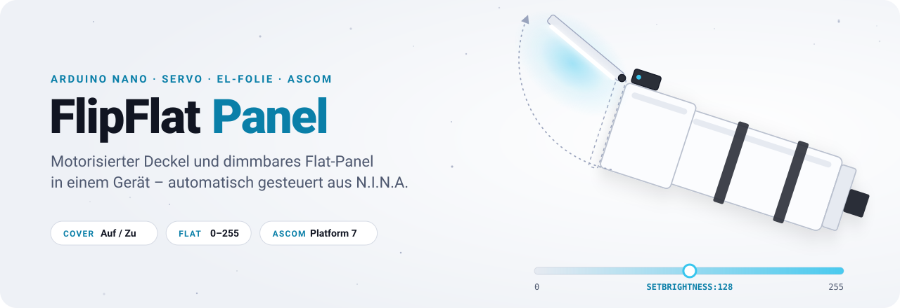
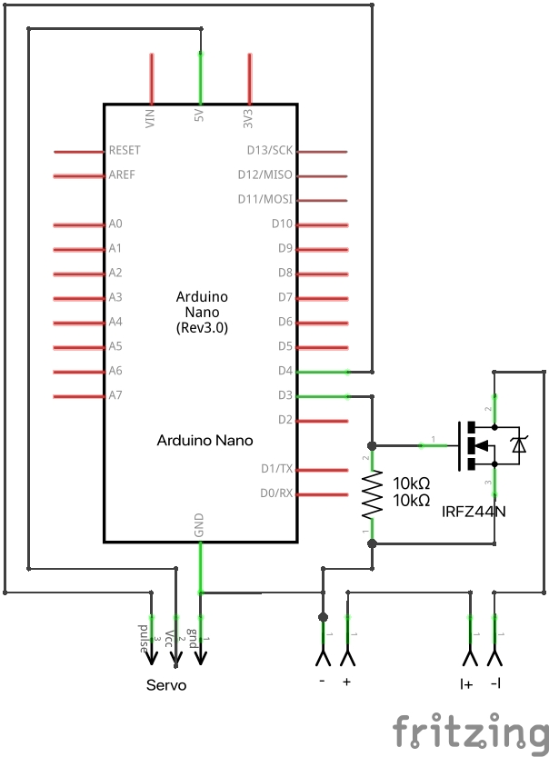
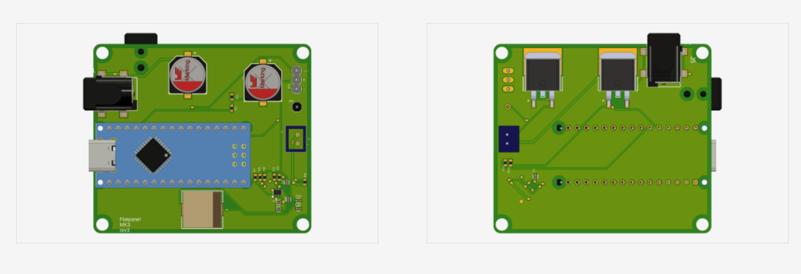
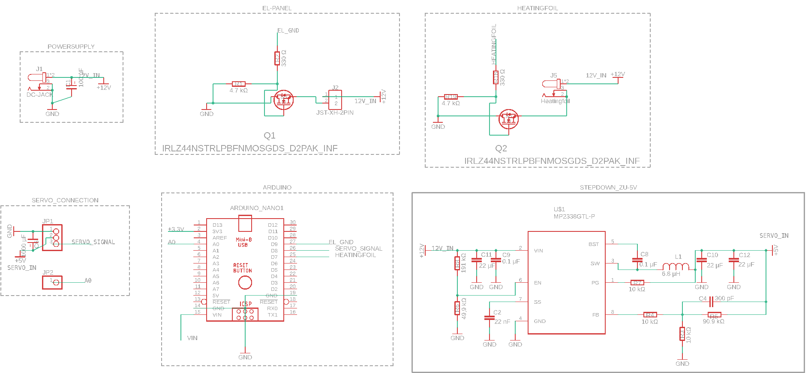

<p align="center">
  <picture>
    <source media="(prefers-color-scheme: dark)" srcset="docs/images/hero-dark.svg">
    <source media="(prefers-color-scheme: light)" srcset="docs/images/hero-light.svg">
    
  </picture>
</p>

<p align="center">
  <a href="https://github.com/lindekai/FlipFlatPanel/actions/workflows/ci.yml"></a>
  
  
  
  
  
  
  <a href="LICENSE"></a>
</p>

<p align="center">
  <a href="#übersicht"><b>Übersicht</b></a> ·
  <a href="#hardware"><b>Hardware</b></a> ·
  <a href="#installation"><b>Installation</b></a> ·
  <a href="#serielles-protokoll"><b>Protokoll</b></a> ·
  <a href="#verwendung-in-nina"><b>N.I.N.A.</b></a> ·
  <a href="#fehlerbehebung"><b>Fehlerbehebung</b></a> ·
  <a href="CHANGELOG.md"><b>Changelog</b></a> ·
  <a href="CONTRIBUTING.md"><b>Mitmachen</b></a>
</p>

Ein DIY Flat-Field-Panel für die Astrofotografie mit Arduino Nano, Servo-Klappe und EL-Folie. Gesteuert wird es über ASCOM CoverCalibrator (Platform 7), zum Beispiel aus N.I.N.A. oder anderer Astro-Software.

> [!NOTE]
> **Credits:** Ursprüngliches Konzept, Schaltung und Hardware-Design stammen von Moritz Mayer / [Dark Matters Discord](https://discord.gg/darkmatters).

## Übersicht

Das FlipFlat Panel kombiniert einen motorisierten Deckel (Flip) mit einem dimmbaren Flat-Field-Panel (Flat) in einem Gerät. Du steuerst es über N.I.N.A., andere ASCOM-kompatible Software oder die mitgelieferte Desktop-App.

<p align="center">
  
</p>

### Funktionen

| | |
|---|---|
| **Cover-Steuerung** | Servo öffnet und schließt den Deckel, Endpunkte und Geschwindigkeit sind einstellbar |
| **SoftClose** | Sanftes Anfahren und Abbremsen (Cosinus-Easing), schont Mechanik und Optik |
| **Helligkeit** | EL-Folie stufenlos dimmbar (0–255) über MOSFET-PWM |
| **EEPROM** | Servo-Einstellungen und die letzte Deckel-Position bleiben nach einem Neustart erhalten |
| **ASCOM CoverCalibrator** | ICoverCalibratorV2-Implementierung für Platform 7 |
| **Desktop-App** | Eigenständige Steuerungs-App mit Serial- und ASCOM-Modus |
| **N.I.N.A. kompatibel** | Automatisierte Flat-Frame-Aufnahme |

## Hardware

### Komponenten

| Bauteil | Beschreibung |
|---------|-------------|
| Arduino Nano (Rev3) | Mikrocontroller, USB-Seriell |
| Servo | Flip-Mechanismus für den Deckel |
| EL-Folie + Inverter | Gleichmäßige Ausleuchtung als Flat-Field-Quelle |
| IRFZ44N / IRLZ44N MOSFET | Schaltet und dimmt den EL-Inverter per PWM |
| 10 kΩ Widerstand | Pull-Down am MOSFET-Gate |
| 12 V DC Netzteil | Stromversorgung für den EL-Inverter |

### Pin-Belegung

| Arduino Pin | Funktion | Beschreibung |
|-------------|----------|-------------|
| D8 | Servo | Manuelle Pulse (kein Timer1, damit PWM auf Pin 9 erhalten bleibt) |
| D9 | MOSFET Gate | PWM-Ausgang für die Helligkeit der EL-Folie |
| D7 | Heizfolie (nur PCB) | Auf der Platine vorbereitet, von der Firmware noch nicht genutzt |
| USB | Serial | 57600 Baud, Steuerungsprotokoll |

### Schaltplan

Der MOSFET schaltet die Masse-Seite des EL-Inverters. Ein 10 kΩ Pull-Down-Widerstand am Gate sorgt dafür, dass die EL-Folie beim Start des Arduino dunkel bleibt.

> [!NOTE]
> Der Fritzing-Plan unten zeigt den ursprünglichen Aufbau (V1.4) mit anderer Pin-Belegung. Maßgeblich für Firmware v3 ist die Tabelle oben bzw. der PCB-Schaltplan.



### PCB

Fertige Gerber-Datei, zum Beispiel für JLCPCB: [`PCB/gerberfile`](PCB/gerberfile) (ZIP-Archiv). Die Platine hat einen Step-down-Wandler von 12 V auf 5 V für den Servo und einen zweiten MOSFET-Kanal für eine Heizfolie.

> [!WARNING]
> Stand 06.05.2026 ist die Platine noch nicht final getestet.

<p align="center">
  
  
</p>

## Software-Architektur

Das Projekt besteht aus drei Komponenten:

```
FlipFlatPanel/
├── 01_Firmware/              Arduino Nano Firmware
│   ├── FlipFlatPanel_v3.ino    aktuell (v3.1)
│   └── FlipFlatPanel_v2.ino    Vorgänger, nur zur Referenz
├── 02_AscomDriver/           ASCOM CoverCalibrator Treiber
│   ├── CoverCalibratorHardware.cs
│   └── SetupDialogForm.cs
├── 03_ControllerApp/         Desktop-Steuerungs-App (WPF, .NET 8)
├── Installer/Build_Scripte/  Inno-Setup-Skripte für beide Installer
├── PCB/                      Gerber-Datei, Layout, Schaltplan
├── docs/                     Bilder und Dokumentation
└── tools/hero.py             erzeugt den Banner dieser README
```

## Installation

### 1. Arduino-Firmware flashen

1. Öffne `01_Firmware/FlipFlatPanel_v3.ino` in der Arduino IDE
2. Board: **Arduino Nano**
3. Prozessor: **ATmega328P** (oder „Old Bootloader“, je nach Nano-Version)
4. COM-Port auswählen
5. Hochladen

**Test im Serial Monitor** (57600 Baud, Newline):
```
COMMAND:PING              → RESULT:PING:OK:16c5e400-a3b1-11ed-87cd-0800200c9a66
COMMAND:OPEN              → RESULT:OPEN:offen
COMMAND:CLOSE             → RESULT:CLOSE:geschlossen
COMMAND:SETBRIGHTNESS:128 → RESULT:SETBRIGHTNESS:128
```

### 2. Fertige Installer

Unter [Releases](https://github.com/lindekai/FlipFlatPanel/releases):

- [FlipFlatPanel_AscomDriver_Setup_1.1.0.exe](https://github.com/lindekai/FlipFlatPanel/releases/download/V.1.1.0/FlipFlatPanel_AscomDriver_Setup_1.1.0.exe) (Pre-Release)
- [FlipFlatPanel_AscomDriver_Setup_1.0.1.exe](https://github.com/lindekai/FlipFlatPanel/releases/download/V.1.0.0/FlipFlatPanel_AscomDriver_Setup_1.0.1.exe)
- [FlipFlatPanel_Controller_Setup_1.2.1.exe](https://github.com/lindekai/FlipFlatPanel/releases/download/V.1.0.0/FlipFlatPanel_Controller_Setup_1.2.1.exe)

Oder selbst bauen:

### 3. Controller-App bauen

**Voraussetzungen:**
- Visual Studio 2022 Community (mit .NET-Desktop-Entwicklung)
- .NET 8.0 SDK

**Schritte:**
1. Öffne `03_ControllerApp/FlipFlatPanel.Controller.csproj` in Visual Studio
2. Erstellen → Projektmappe erstellen (F6)
3. Starten mit F5

**Funktionen der App:**
- **Direkt-Modus (Serial):** kommuniziert direkt mit dem Arduino, inklusive Servo-Einstellungen
- **ASCOM-Modus:** steuert über den installierten ASCOM-Treiber
- **Helligkeits-Direkteingabe:** exakte Werte per Textfeld und Enter
- **Protokoll-Fenster:** zeigt alle gesendeten Befehle und Antworten

### 4. ASCOM-Treiber bauen

**Voraussetzungen:**
- ASCOM Platform 7.x ([Download](https://ascom-standards.org/Downloads/Index.htm))
- Visual Studio 2022 mit der Extension „ASCOM Platform 7 Templates“

**Schritte:**
1. Visual Studio → Neues Projekt → **ASCOM Platform 7 Driver**
2. Device Class: **CoverCalibrator**
3. Vendor/Organization: **FlipFlatPanel**
4. Device Name/Model: **FlipFlatPanel**
5. Erstellen
6. Die generierten Dateien `CoverCalibratorHardware.cs` und `SetupDialogForm.cs` durch die Dateien aus `02_AscomDriver/` ersetzen
7. NuGet-Paket **System.IO.Ports** hinzufügen
8. Erstellen (F6)
9. Als Administrator registrieren: `ASCOM.FlipFlatPanel.exe /register`

## Serielles Protokoll

Baudrate 57600, 8N1, Zeilenende `\n`. Ungültige Befehle beantwortet die Firmware mit `ERROR:INVALID_COMMAND`.

| Befehl | Antwort | Beschreibung |
|--------|---------|-------------|
| `COMMAND:PING` | `RESULT:PING:OK:<GUID>` | Verbindungstest |
| `COMMAND:INFO` | `RESULT:INFO:FlipFlatPanel Firmware v3.1` | Firmware-Info |
| `COMMAND:OPEN` | `RESULT:OPEN:offen` | Cover öffnen (antwortet erst nach der Fahrt) |
| `COMMAND:CLOSE` | `RESULT:CLOSE:geschlossen` | Cover schließen (antwortet erst nach der Fahrt) |
| `COMMAND:POSITION` | `RESULT:POSITION:<status>` | Cover-Status: `offen`, `geschlossen`, `unknown` (wird ab v3.1 über einen Reset hinweg gemerkt) |
| `COMMAND:BRIGHTNESS` | `RESULT:BRIGHTNESS:<0-255>` | Aktuelle Helligkeit |
| `COMMAND:SETBRIGHTNESS:<0-255>` | `RESULT:SETBRIGHTNESS:<0-255>` | Helligkeit setzen |
| `COMMAND:MAXBRIGHTNESS` | `RESULT:MAXBRIGHTNESS:255` | Maximale Helligkeit |

**Neu in v3.0:**

| Befehl | Antwort | Beschreibung |
|--------|---------|-------------|
| `COMMAND:SETOPEN:<500-2500>` | `RESULT:SETOPEN:<µs>` | Pulsbreite „offen“ |
| `COMMAND:SETCLOSE:<500-2500>` | `RESULT:SETCLOSE:<µs>` | Pulsbreite „geschlossen“ |
| `COMMAND:GETOPEN` / `GETCLOSE` | `RESULT:GETOPEN:<µs>` / `RESULT:GETCLOSE:<µs>` | Endpunkte abfragen |
| `COMMAND:SETSPEED:<1-10>` | `RESULT:SETSPEED:<1-10>` | Geschwindigkeit (1 = langsam) |
| `COMMAND:GETSPEED` | `RESULT:GETSPEED:<1-10>` | Geschwindigkeit abfragen |
| `COMMAND:SETSOFTCLOSE:<0\|1>` | `RESULT:SETSOFTCLOSE:<0\|1>` | SoftClose ein/aus |
| `COMMAND:GETSOFTCLOSE` | `RESULT:GETSOFTCLOSE:<0\|1>` | SoftClose abfragen |
| `COMMAND:SAVE` | `RESULT:SAVE:OK` | Einstellungen ins EEPROM schreiben |

`SET…`-Befehle wirken sofort, gehen beim Neustart aber verloren, bis `COMMAND:SAVE` gesendet wird.

## Verwendung in N.I.N.A.

1. ASCOM-Treiber installieren oder registrieren (siehe oben)
2. N.I.N.A. starten
3. Geräte → Flatpanel → ASCOM CoverCalibrator wählen
4. **FlipFlat Panel** auswählen
5. In den Eigenschaften den COM-Port einstellen
6. Verbinden

Für automatisierte Flat-Frames kann N.I.N.A. den Deckel schließen, die Helligkeit einstellen und nach der Aufnahme den Deckel wieder öffnen.

## Technische Details

### Servo-Steuerung

Die Firmware erzeugt die Servo-Pulse selbst statt über die Arduino-Servo-Library. Die Library belegt Timer1 und würde damit den PWM-Ausgang auf Pin 9 stören. Die Bewegung läuft schrittweise mit 50-Hz-Pulsen. Die Geschwindigkeit (1–10) bestimmt die Pause zwischen den Schritten, SoftClose bremst am Anfang und Ende ab.

Bei Geschwindigkeit 5 dauert eine volle Fahrt rund 9 Sekunden, bei Geschwindigkeit 1 deutlich länger. Treiber und App warten deshalb bis zu 30 Sekunden auf die Antwort. Während einer Fahrt nimmt die Firmware keine weiteren Befehle an, ein Helligkeitsbefehl wird erst danach ausgeführt.

### ASCOM CoverCalibrator V2

Der Treiber implementiert das ICoverCalibratorV2-Interface (Platform 7) mit:
- `Connect()` / `Disconnect()` (asynchron, Platform 7)
- `Connected` Property (Rückwärtskompatibilität, Platform 6)
- `OpenCover()` / `CloseCover()` asynchron: kehren sofort zurück, die Fahrt läuft im Hintergrund (Fortschritt über `CoverState` / `CoverMoving`)
- `HaltCover()` wirft `MethodNotImplementedException`, weil die Firmware eine laufende Fahrt nicht abbrechen kann
- `CalibratorOn(brightness)` / `CalibratorOff()`
- `CoverState` / `CoverMoving`
- `CalibratorState` / `CalibratorChanging`
- `Brightness` / `MaxBrightness`

### Servo-Endpunkte anpassen

Seit v3.0 musst du dafür nichts mehr neu flashen. Stelle die Endpunkte in der Controller-App ein (Direkt-Modus), teste sie mit „Test Open/Close“ und speichere sie dann ins EEPROM. Die Standardwerte in der Firmware sind:

```cpp
const int DEFAULT_OPEN_PULSE  = 2500;  // Mikrosekunden
const int DEFAULT_CLOSE_PULSE = 540;   // Mikrosekunden
```

## Fehlerbehebung

| Problem | Lösung |
|---------|--------|
| Servo reagiert nicht | Servo-Signal an **D8**? Firmware v3.1 flashen; Endpunkte in der App prüfen |
| Timeout beim Öffnen/Schließen | Geschwindigkeit erhöhen oder SoftClose testen; Treiber/App ≥ aktuelle Version verwenden |
| EL-Folie leuchtet nicht | MOSFET-Verdrahtung prüfen; `COMMAND:SETBRIGHTNESS:255` testen |
| ASCOM-Timeout | COM-Port prüfen; Serial Monitor schließen |
| Treiber nicht in N.I.N.A. | `/register` als Administrator ausführen |
| Arduino wird nicht erkannt | CH340/FTDI-Treiber installieren |

## Lizenz

MIT License, siehe [LICENSE](LICENSE). Ursprüngliches Konzept und Hardware-Design: Moritz Mayer / [Dark Matters Discord](https://discord.gg/darkmatters).

## Mitmachen

Pull Requests und Issues sind willkommen! Die Regeln (Pin-Belegung, abwärtskompatibles Protokoll, ConformU) stehen in [CONTRIBUTING.md](CONTRIBUTING.md), Änderungen im [CHANGELOG](CHANGELOG.md).
